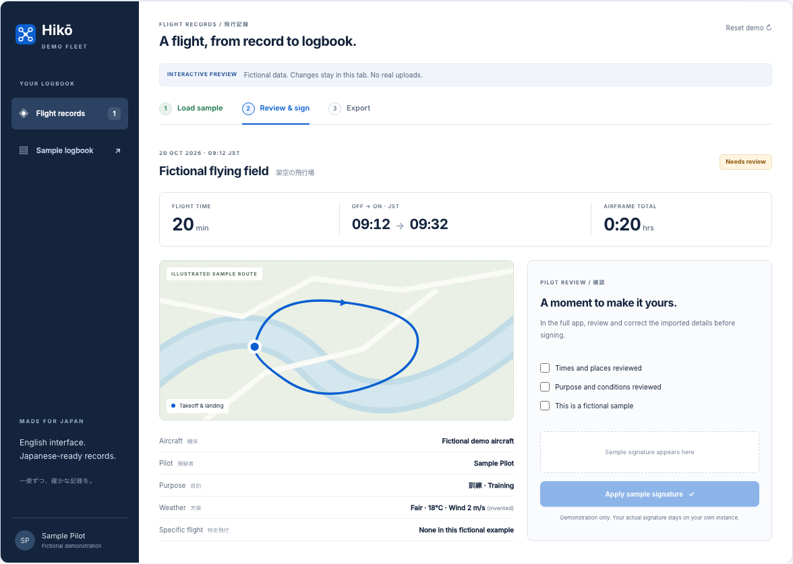
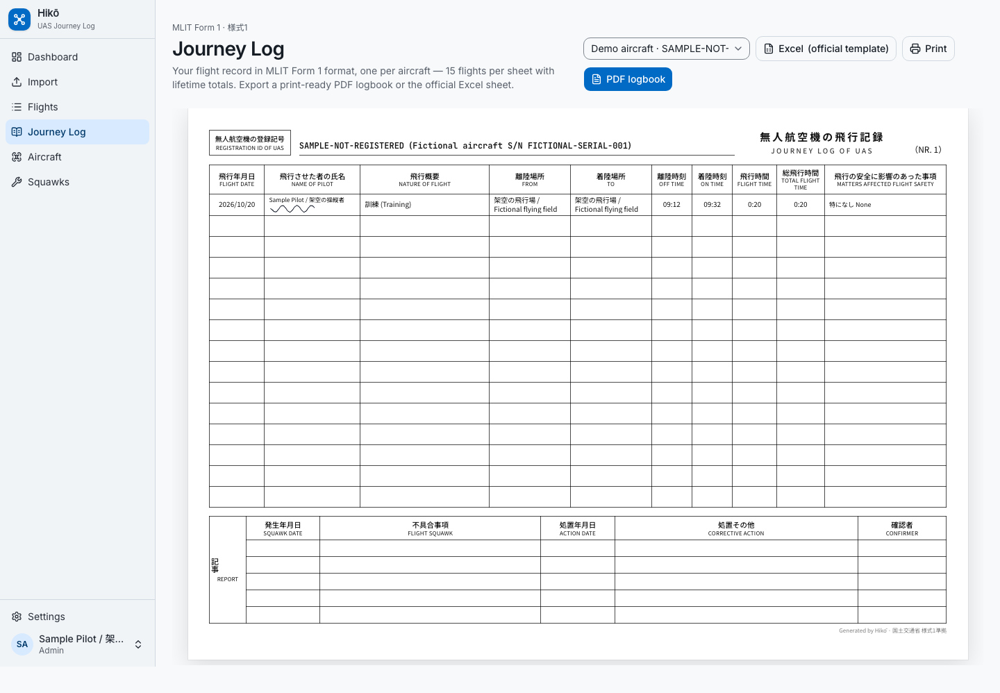

<p align="center"></p>

# Hikō · 飛行日誌

**A self-hosted drone logbook for pilots flying in Japan.**

Import DJI flight records, review and sign your flights, and export bilingual PDF and Excel records in **MLIT Form 1** format.

[](https://github.com/eliemada/hiko/actions/workflows/ci.yml)
[](LICENSE)
[](https://github.com/eliemada/hiko/releases)

**[Try the demo](https://eliemada.github.io/hiko/)** · [Sample PDF](demo/assets/sample-signed.pdf) · [Sample Excel](demo/assets/sample-signed.xlsx) · [日本語](README.ja.md)



[Watch the short walkthrough](docs/media/walkthrough.mp4). The demo and all public samples use fictional records. No account, DJI key, or personal log is needed.

## What it does

- **Import DJI Fly records:** decode supported logs, detect airborne segments, and keep original files for reprocessing. Encrypted logs need your DJI Open API key.
- **Log flights manually:** useful for other aircraft, unsupported files, or a quick entry after landing.
- **Review in English:** bilingual purpose and safety notes, flight maps, weather enrichment, and suggested specific-flight conditions. Pilots verify the details.
- **Sign and keep records:** drawn signatures, locked signed entries, per-aircraft running totals, and a shared fleet logbook.
- **Export PDF and Excel:** a PDF cover and flight-record sheets, unsigned PDF draft markings, and the filled MLIT workbook.
- **Run it yourself:** Node.js or a non-root Docker container with a persistent SQLite database and raw-log archive.

**Public beta:** this is an independent project, not an MLIT or DJI product. It covers **Form 1 flight records**; Forms 2 and 3 for inspections and maintenance, permissions, and DIPS submissions are separate. See [MLIT's guidance](https://www.mlit.go.jp/koku/operation.html) and [scope and limitations](docs/compatibility.md).

<details>
<summary>See the actual application's logbook screen, with a fictional signed flight</summary>



</details>

## Quick start

Use Node.js 24 LTS and Docker Compose v2 for this setup. A [Docker-only setup](docs/self-hosting.md#without-nodejs-on-the-host) is also available.

```bash
git clone https://github.com/eliemada/hiko.git
cd hiko
node scripts/setup.mjs --docker
docker compose pull
docker compose up -d --wait
```

Open **http://localhost:3000** and create the first account, which becomes administrator. Compose binds to localhost by default. Every instance is **one trusted fleet**: members share the logbook and pilot directory. Accounts are not isolated for unrelated users.

The setup helper creates `.env` with unique secrets and preserves an existing file. Before remote access, configure HTTPS and `BETTER_AUTH_URL`; set `DJI_API_KEY` to decode encrypted logs. Manual entry works without a DJI key.

[Self-hosting, upgrades, backups, and restore](docs/self-hosting.md) · [Data and privacy](PRIVACY.md) · [Security reporting](SECURITY.md)

### Run from source

```bash
npm ci
npm run setup:local
npm run dev
```

Migrations run at startup. Local data defaults to `./data`. For a production Node server, run `npm run build` and `npm start`; the start script prepares and launches Next.js's standalone output.

To build your own container: `docker compose up -d --build --wait`.

## DJI compatibility

| Input | Behavior |
| --- | --- |
| Manual entry | No DJI account or API key required. |
| Supported unencrypted DJI TXT logs | Decoded by `dji-log-parser-js`. |
| Supported encrypted TXT logs, version 13+ | Your DJI Open API key is needed for the first keychain fetch. |
| Encrypted log without a configured key | Header-only import where possible; estimated times need review. |
| Other vendors, CSV, DAT, unsupported or corrupt logs | Use manual entry; no import compatibility is claimed. |

Real-device coverage is still being collected. A model name in an example does not certify support. See the [compatibility matrix and file-location guide](docs/compatibility.md).

## Development and checks

```bash
npm run lint
npm run typecheck
npm test
npx playwright install chromium
npm run e2e          # production build + temporary database + manual pilot journey
npm run demo:build
npm run test:demo    # desktop and mobile; no third-party data requests
```

The app smoke test needs no personal logs or external APIs. A separate real-log test is opt-in with `E2E_FIXTURES` pointing to private files. Container CI checks startup, restart persistence, backup, and restore on AMD64 and ARM64.

[Contribute](CONTRIBUTING.md) · [Architecture](docs/architecture.md) · [Roadmap](docs/roadmap.md) · [Changelog](CHANGELOG.md)

## Help improve it

[Report a bug or compatibility result](https://github.com/eliemada/hiko/issues/new/choose). Include the app version, aircraft/controller, DJI Fly version, and expected behavior. **Keep raw logs, GPS tracks, serial numbers, signatures, and keys out of public issues.**

Built with Next.js, React, TypeScript, Drizzle, SQLite/libSQL, Better Auth, MapLibre, ExcelJS, and the DJI log parser. Original code is [MIT licensed](LICENSE); bundled materials retain their [third-party notices](THIRD_PARTY_NOTICES.md).
