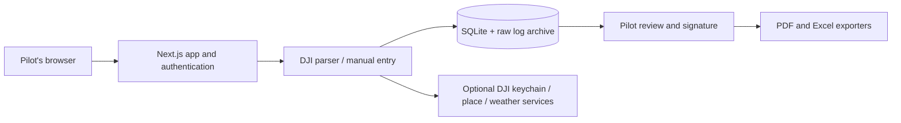

# Architecture

Hikō is a single Next.js application deployed as a long-running Node process. A deployment belongs to one trusted fleet. Its public demo is an independent static site.

| Location | Responsibility |
| --- | --- |
| `src/app` | Routes, server actions, authenticated screens, export/import endpoints. |
| `src/lib/dji`, `src/lib/flight` | Decoding, segment extraction, time calculations, suggestions. |
| `src/lib/db`, `drizzle` | Schema, migrations, data access. |
| `src/lib/server` | Sessions, ingestion, queries, journal loading. |
| `src/lib/export` | Shared journal rows and PDF/XLSX rendering. |
| `src/lib/enrich` | Optional reverse geocoding and weather. |
| `demo` | Fictional browser-only workflow, deployed to GitHub Pages. |
| `scripts` | Setup, standalone start, demo/media generation, container verification. |
| `e2e` | Isolated application and static-demo browser tests. |

Proxy redirects are an optimistic convenience; the server checks sessions again. Mutations enforce pilot/admin rules. Queries intentionally expose the fleet's shared records to authenticated members; there is no tenant boundary between those members.

Container startup runs migrations. Raw logs and SQLite share `/data`; cached keychains live in the database. Backups must include the entire data volume. A stopped-volume snapshot avoids inconsistency between files and database state.

The demo never imports server modules or opens a database. Its sample exports are generated at development/build time using the real exporters, with a single fictional fixture in `scripts/build-demo.mts`.
